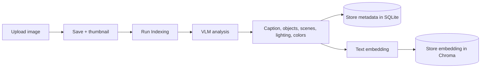
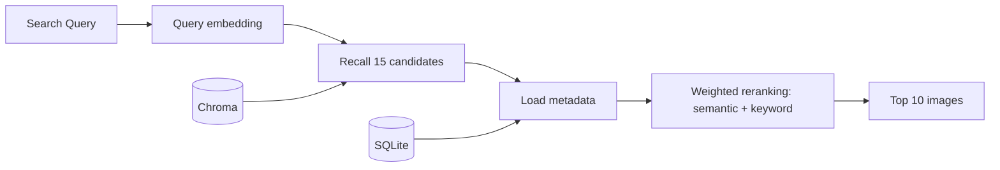

# Vision-Index
**Local-first multimodal image indexing and semantic retrieval system**

## Introduction

Vision-Index lets users upload images and search them with natural-language queries. 

It combines local VLM-based image understanding, text embeddings, vector retrieval, and two-stage search with reranking, all accessible through a FastAPI web dashboard.

**Tech Stack:** Python · FastAPI · Ollama · SQLite · ChromaDB

---

## Demo

### Upload Images, Run Indexing, and Inspect Metadata


### Search by Queries and Inspect Ranking Scores


---

## Key Features

- **Local image understanding:** generate captions, objects, scenes, lighting, and colors through Ollama.
- **Semantic search:** retrieve images using embeddings of their generated descriptions.
- **Explainable ranking:** combine semantic similarity with field-level keyword scores.
- **Search evaluation:** measure retrieval quality on annotated queries.

---

## Pipeline Architecture

### Image Indexing


### Image Search



Search has two stages:

1. **Recall:** retrieve 15 candidates by vector distance.
2. **Rerank:** combine semantic and field-level keyword scores, then return the top 10.

Implementation: [Indexing](app/services/pipeline.py) · [Search and scoring](app/services/search.py) · [Model calls](app/ai/llm.py)

---

## Evaluation

The current offline evaluation uses 15 manually curated queries covering:
- object search
- scene search
- visual attributes
- compositional queries

| Top-1 Accuracy | Precision@5 | Recall@5 |
|---:|---:|---:|
| 80.00% | 57.33% | 70.60% |

Historical results from the weight-selection benchmark, not a held-out test set.

---

## Quick Start

Install and start [Ollama](https://ollama.com/download), then download models:

```bash
ollama pull qwen3.5:4b
ollama pull nomic-embed-text:latest
git clone https://github.com/wyjxx/vision-index.git
cd vision-index
```

Choose one route:

### 1. Docker

Install and start [Docker](https://www.docker.com/products/docker-desktop/), then run:

```bash
docker compose up --build
```

Open [localhost:8000](http://localhost:8000). Data persists in `gallery/` and `data/`.

### 2. Local Python

Install Python 3.12, then run:

```bash
python -m venv .venv
python -m pip install -r requirements.txt
python -m uvicorn app.main:app --reload
```

Open [localhost:8000](http://localhost:8000).
