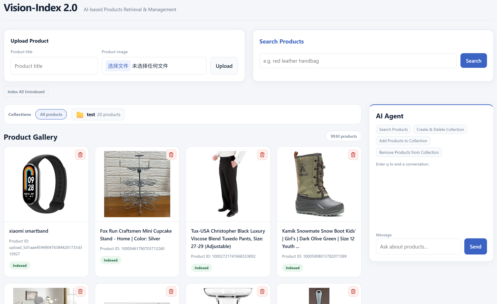
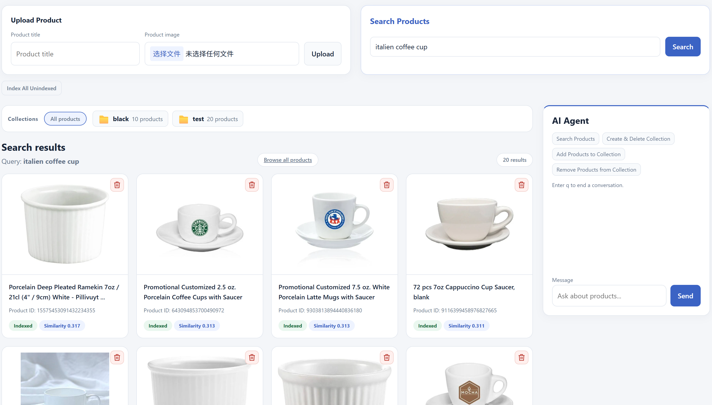
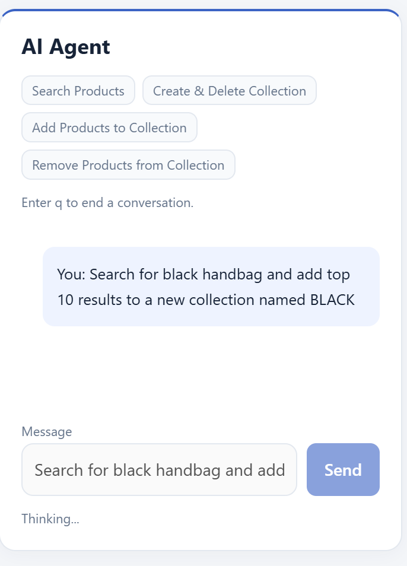
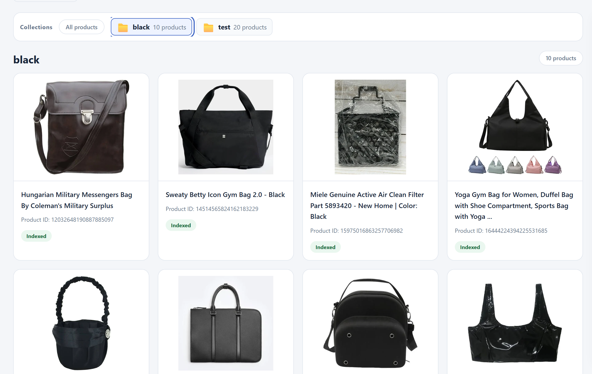
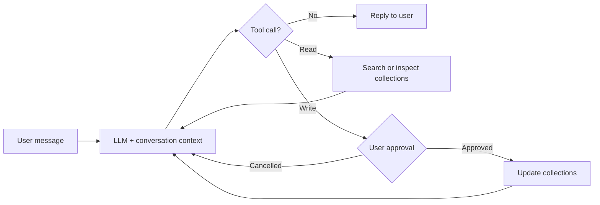

# Vision-Index: AI-Assisted E-commerce Product Search & Management

**Conversational AI Agent · CLIP-based Retrieval · Projection-Layer Fine-tuning · Multi-Scenario Evaluation**

## Introduction

Vision-Index is an interactive application for finding and organizing e-commerce products. 

Users can browse products, upload images, search with natural language, and manage collections through a conversational AI agent.

The project also includes CLIP projection-layer fine-tuning and an offline evaluation pipeline to measure retrieval performance across three test scenarios.

**Tech Stack:** Python · PyTorch · Hugging Face · CLIP · FastAPI · SQLite · ChromaDB · DeepSeek · LangChain · LangGraph


## Demo

### Upload Images and Run Indexing



### Search Products and Inspect Scores



### Manage Collections through AI Chat

<p align="center">
  
  
</p>
---

## Key Features

- **Interactive Web Dashboard:** Built with FastAPI and supports product browsing, image uploads, semantic search, and an integrated agent chat panel.
- **Conversational AI Agent:** Uses DeepSeek and LangGraph to search products, inspect collections, create or delete collections, and add or remove products through multi-turn chat.
- **Efficient Retrieval:** Runs CLIP locally to encode product images and text queries, searches image vectors in ChromaDB, and retrieves product metadata from SQLite.
- **Real-world E-commerce Data:** Processed 9,934 products from the Marqo-GS-10M dataset, including product images, metadata, and query–product pairs. 
- **CLIP Fine-tuning:** Trains text and image projection layers while keeping both encoders frozen.
- **Multi-Scenario Retrieval Evaluation:** Compares pretrained and fine-tuned CLIP using full-catalog Recall@K and nDCG@K, including unseen-query tests.

---

## Pipeline Architecture

### Image Indexing


### Product Search


### Conversational AI Agent



**Model:** `openai/clip-vit-base-patch32` · normalized 512-dimensional embeddings.

Implementation: [Indexing](app/services/index.py) · [Search](app/services/search.py) · [CLIP encoders](app/ai/clip.py)

---

## Fine-tuning & Evaluation

Training uses 10,000 query–product pairs from [Marqo-GS-10M](https://huggingface.co/datasets/Marqo/marqo-GS-10M), `in_domain-350.parquet`, split by unique pair into train / validation / test at 80% / 10% / 10%.

**Projection fine-tuning:** fine-tunes CLIP's image and text projection layers while keeping both encoders frozen.

**Fine-tuned Epoch 4 vs. pretrained CLIP:** evaluated across 3 retrieval scenarios

| Query | Images | Domain similarity | Recall@100 | nDCG@10 | nDCG@50 | nDCG@100 |
|---|---|---|---:|---:|---:|---:|
| Seen | Unseen* | Same | +31.0% | +65.3% | +43.5% | +41.7% |
| Unseen | Unseen* | Similar | −1.8% | +19.4% | +3.0% | +3.4% |
| Unseen | Unseen* | Shifted toward women's fashion | −2.3% | −6.1% | −4.5% | −3.2% |

*Seen/unseen indicates whether queries or images were used during fine-tuning. Domain similarity describes how closely the test product themes match the training data.*


---

## Quick Start

Choose one option below. Run all commands from the project root.

### Option 1: Local Python

```powershell
python -m venv .venv
.\.venv\Scripts\Activate.ps1
python -m pip install -r requirements.txt
python -m scripts.setup_demo
python -m uvicorn app.main:app --reload
```

### Option 2: Docker

With Docker running:

```powershell
docker compose run --rm --build app python -m scripts.setup_demo
docker compose up --build -d
docker compose ps
```

### Using the App

`setup_demo` downloads the [500-product demo package](https://github.com/wyjxx/vision-index/releases/tag/demo-data-500) (11 MB) and imports it into SQLite, stored in `data/v2/`.

Open [localhost:8000](http://localhost:8000), click **Index All Unindexed**, then search. You can also upload your own products. CLIP weights are downloaded on first use.

---

## Legacy V1

The original version is preserved in `app_legacy/` for general photo retrieval.

| | V1 — Photo search | V2 — Product search |
|---|---|---|
| Image representation | Qwen VLM caption → Nomic text embedding | CLIP image embedding |
| Query representation | Nomic text embedding | CLIP text embedding |
| Retrieval | Vector search + keyword reranking | Cosine vector search |

With the Python dependencies installed, Ollama running, and `qwen3.5:4b` / `nomic-embed-text:latest` available, start V1 with:

```powershell
python -m uvicorn app_legacy.main:app --reload --port 8001
```

Open [localhost:8001](http://localhost:8001). See the [Legacy README](app_legacy/README.md) for setup, screenshots, and implementation details.
