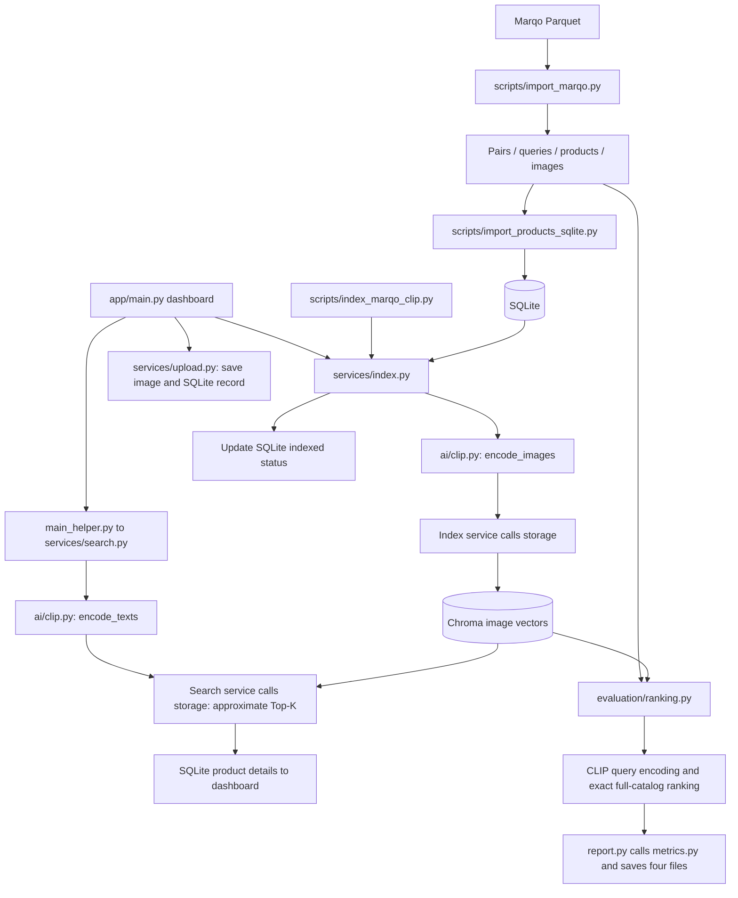

# Vision-Index 2.0 — Technical Notes

V2 searches product images with CLIP. Product images are encoded in advance; a text query is encoded at search time and matched against those image vectors. V1 remains separate in `app_legacy/`.

## 1. Marqo Data

Source: [Marqo-GS-10M](https://huggingface.co/datasets/Marqo/marqo-GS-10M). The current subset uses `in_domain-350.parquet`, containing query text, product IDs, titles, reference ranks (`position`), and image bytes.

`scripts/import_marqo.py` follows this flow:

```text
Read query_id, product_id, position
→ Deduplicate by (query_id, product_id)
→ Randomly sample N pairs; default seed=42
→ Split pairs into train / validation / test
→ Export the selected query text, product metadata, and original images
```

The current dataset has **10,000 pairs, 200 queries, and 9,934 products**.

| Split | Pairs | Purpose |
| --- | ---: | --- |
| Train | 8,000 | Fine-tuning |
| Validation | 1,000 | Hyperparameter and checkpoint selection |
| Test | 1,000 | Final comparison; 198 queries |

Pairs do not overlap across splits. Queries and products can overlap. All current test queries also appear in train, so this evaluates held-out pairs, not unseen-query generalization.

Files live in `data/v2/marqo/`:

| File | Contents |
| --- | --- |
| `in_domain-350.parquet` | Original shard |
| `train.jsonl`, `validation.jsonl`, `test.jsonl` | One pair per line: query_id, product_id, position |
| `queries.jsonl` | Query ID → query text |
| `products.jsonl` | Product ID → title and relative image path |
| `images/` | One image per product, in its original format |
| `config.json` | Source files, sample size, split ratios, and seed |

IDs are strings to preserve large integers. Reference positions are kept unchanged after sampling.

## 2. CLIP: Indexing and Search

Model: **`openai/clip-vit-base-patch32`**, implemented in `app/ai/clip.py`.

| Function | Role |
| --- | --- |
| `load_clip()` | Cache one model instance per process; CUDA/FP16 when available, otherwise CPU/FP32 |
| `encode_images()` | Images → normalized 512-dimensional vectors |
| `encode_texts()` | Query text → normalized vectors in the same space |

**Indexing**, in `services/index.py`: read SQLite products with `indexed=0`, encode images in batches of 32, write vectors to Chroma, then mark the batch indexed. Completed products are skipped on reruns. A file lock prevents concurrent indexing jobs.

**Search**, in `services/search.py`: encode the query → Chroma approximate Top-K search → load product details from SQLite. Images are not re-encoded during search. The dashboard returns 10 products by default.

Services call AI and storage directly. **Storage never calls the model.**

## 3. Storage

| Location | Contents |
| --- | --- |
| `data/v2/products.db` | SQLite: product ID, title, image path, source, indexed status, creation time |
| `data/v2/clip_vector/` | Chroma image vectors, IDs, and metadata such as titles and image paths |
| `data/v2/marqo/images/` | Dataset images |
| `data/v2/uploads/images/` | Uploaded images |
| `data/v2/models/` | Model cache |

JSONL files support data preparation, import, and evaluation. The running app reads product metadata from SQLite. Images stay on disk.

## 4. FastAPI Dashboard

Entry point: `app/main.py`. Gallery and search results use the same template.

| Action / route | Flow |
| --- | --- |
| Browse: `GET /` | Read a SQLite page, default 24 products → attach image URLs → render |
| Upload: `POST /upload` | `services/upload.py` validates the title and image → save image and SQLite record as unindexed |
| Index: `POST /run-pipeline` | Run `index_unindexed_products()` for all pending products → return to the gallery |
| Search: `GET /search/clip?q=...` | `main_helper.py` → search service → attach image URLs → render |

`main_helper.py` prepares image URLs and search results for the page. Images are served through `/product-images/` and `/uploaded-images/`.

## 5. Evaluation

Entry point: **`evaluation/ranking.py:main()`**.

```text
Read queries and labels from the selected split
→ Fix the candidate set using products.jsonl
→ Read existing image vectors from Chroma
→ Encode each query with CLIP
→ Compute cosine similarity against every candidate and sort in float32
→ Score each query and save labeled pair ranks
→ Average query metrics and save the summary
```

The candidate set contains 9,934 products. Later uploads are excluded unless added to the dataset catalog. Evaluation uses exact ranking, not Chroma HNSW search or the dashboard's Top-K limit. Equal scores are ordered by product ID, ascending as strings.

### Code Responsibilities

| File | Role |
| --- | --- |
| `dataset.py` | Group the selected split's query text and reference positions by query ID |
| `ranking.py` | Coordinate evaluation; `rank_products()` produces full-catalog similarities and ranks |
| `metrics.py` | Pure Recall@K and nDCG@K calculations |
| `report.py` | Load scoring labels, calculate query reports, write details, and build the summary |

In `report.py`, `write_query_outputs()` calls `build_query_report()` for each query. `build_summary()` aggregates the reports. `load_known_labels()` supplies merged annotations.

### Two Label Scopes

| Report field | Labels used | Interpretation |
| --- | --- | --- |
| `test_pairs` | Selected split only | Held-out pair performance; this field uses validation labels when evaluating validation |
| `all_known_pairs` | Train + validation + test for test runs; train + validation for validation runs | Known catalog relevance, including training pairs; not evidence of generalization on its own |

Both scopes score the same ranking. **No products are removed and no ranks are compressed.** Unlabeled products receive zero gain but are not necessarily irrelevant. Reference `position` comes from Google Shopping ranking, not CLIP distance.

### Metrics

```text
Recall@K = labeled products found in the original top K / all labeled products for the query

gain = 101 - reference_position
DCG@K = sum(gain / log2(model_rank + 1)) over the first K model positions
IDCG@K = DCG of the ideal top K, sorting all labeled products by descending gain
nDCG@K = DCG@K / IDCG@K
```

`reference_position` is the dataset rank. `model_rank` is the model's rank in the current catalog. K counts result positions, not relevant products.

We calculate Recall@10/50/100, nDCG@10/50/100, and full-catalog nDCG. Scores are calculated per query, then averaged equally across queries. Mean and median ranks are diagnostics; a single product moving upward does not prove better relevance ordering.

### Saved Results

| File | Contents |
| --- | --- |
| `config.json` | Model, candidate count, data/vector hashes, evaluation settings, completion status |
| `pair_rankings.jsonl` | Every labeled pair in the selected split: similarity, model_rank, reference_position, including low-ranked pairs |
| `per_query_metrics.jsonl` | Both metric scopes and rank statistics for each query |
| `summary.json` | Average metrics across queries |

Full rankings are used in memory, not written to a large file. No Top-100 file is saved. Metrics are calculated before reducing the output, so compact storage does not change the scores.

## 6. Pipeline Diagram



## 7. Project Structure

```text
vision-index/
├── app/                       # V2 application
│   ├── main.py                # Routes and page entry points
│   ├── main_helper.py         # Image URLs and page data
│   ├── config.py              # Paths, model, batch size, and defaults
│   ├── ai/clip.py             # Model loading and encoders
│   ├── services/              # index.py, search.py, upload.py: application flows
│   ├── storage/               # sqlite_db.py, clip_vector_db.py: persistence
│   ├── templates/             # Page template
│   └── static/                # CSS
├── scripts/                   # Data import, CLI indexing, and search
├── evaluation/                # dataset.py, ranking.py, metrics.py, report.py
├── tests/                     # Metrics, exact ranking, and output checks
├── app_legacy/                # V1 code, documentation, and evaluation
├── data/
│   ├── legacy/                # V1 gallery, SQLite, and vectors
│   └── v2/
│       ├── marqo/             # Raw Parquet, exported JSONL, and images/
│       ├── uploads/images/    # Uploaded images
│       ├── models/            # CLIP cache
│       ├── products.db        # Product metadata
│       ├── clip_vector/       # Image vectors
│       └── evaluation/        # Experiment outputs
├── doc/                       # Screenshots
├── requirements.txt           # Unified dependencies
├── Dockerfile                 # Container build; deployment validation pending
└── compose.yaml               # Container runtime configuration
```

## 8. Commands

Run from the project root with Python 3.12. See [README](README.md) for CUDA PyTorch installation.

```powershell
.\.venv\Scripts\Activate.ps1
python -m pip install -r requirements.txt
```

**Prepare data once.** Place `in_domain-350.parquet` in `data/v2/marqo/`, then run:

```powershell
python scripts/import_marqo.py --data-dir data/v2/marqo --pair-count 10000
```

The default split is 80% / 10% / 10%. Adjust `--train-ratio`, `--val-ratio`, or `--seed` as needed. Existing outputs are never overwritten. For another sample, choose a new `--output-dir` and update the application data paths accordingly.

**Import products, index images, and start the dashboard:**

```powershell
python -m scripts.import_products_sqlite
python -m scripts.index_marqo_clip --batch-size 32
python -m uvicorn app.main:app --reload
```

Import skips existing IDs; it does not clear old products. Indexing handles only pending products. You can also click **Index All Unindexed** on the dashboard. Open http://127.0.0.1:8000.

**Search from the terminal:**

```powershell
python -m scripts.search_clip --query "orange juicer" --limit 5
```

**Inspect labels and run evaluation:**

```powershell
python -m evaluation.dataset --split test
python -m evaluation.ranking --split validation --limit 3 --output-dir data/v2/evaluation/validation_check
python -m evaluation.ranking --split test --output-dir data/v2/evaluation/baseline_test_run2
```

`--limit 3` limits queries only; each query still ranks every candidate. Each output directory must be new. The existing baseline is in `data/v2/evaluation/baseline_test/`; there is no need to rerun it.

**Run tests:**

```powershell
python -m unittest discover -s tests -p "test_*.py" -v
```

## 9. Progress and Next Step

Completed: data preparation, pretrained CLIP integration, SQLite/Chroma storage, upload/gallery/search, and full-catalog quality evaluation on 198 test queries.

| Metric | Test labels only | All known labels |
| --- | ---: | ---: |
| Recall@100 | 0.6318 | 0.6435 |
| nDCG@10 | 0.0952 | 0.3746 |
| Full-catalog nDCG | 0.2977 | 0.6670 |

This is a preliminary baseline on a fixed product subset. Compare models within each label scope, not between scopes or against official full-dataset scores. Query latency, index build cost, and resource usage have not been measured.

**Next: fine-tune CLIP.** Train on train pairs and select the model using validation. Re-encode images and queries with the selected checkpoint, then compare against the baseline using the same candidates and scoring rules. Keep baseline vectors and results separate.
