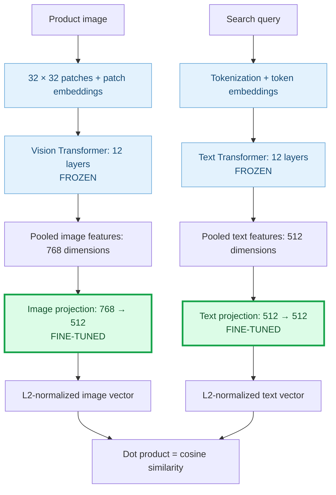
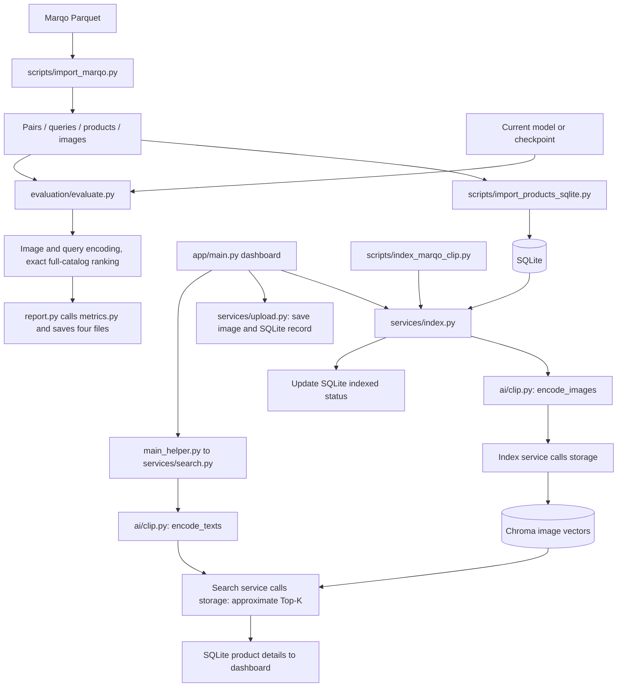

# Vision-Index 2.0 — Technical Notes

V2 searches product images with CLIP. Product images are encoded in advance; a text query is encoded at search time and matched against those image vectors. V1 remains separate in `app_legacy/`.

## 1. Marqo Data

Source: [Marqo-GS-10M](https://huggingface.co/datasets/Marqo/marqo-GS-10M). The current subset uses `in_domain-350.parquet`, containing query text, product IDs, titles, reference ranks (`position`), and image bytes.

`scripts/import_marqo.py` follows this flow:

```text
Read query_id, product_id, position
→ Deduplicate by (query_id, product_id)
→ Randomly sample N pairs; default seed=42
→ Split pairs into train / validation / test
→ Export the selected query text, product metadata, and original images
```

The current dataset has **10,000 pairs, 200 queries, and 9,934 products**.

| Split | Pairs | Purpose |
| --- | ---: | --- |
| Train | 8,000 | Fine-tuning |
| Validation | 1,000 | Hyperparameter and checkpoint selection |
| Test | 1,000 | Final comparison; 198 queries |

Pairs do not overlap across splits. All 198 test queries appear in train. The cleaned test excludes 14 pairs sharing a training product ID or image-file hash, leaving 986 pairs with unseen images in `data/v2/marqo_seen_query_unseen_images/`. The original splits and full candidate catalog are preserved. Near-duplicate images were not checked.

Files live in `data/v2/marqo/`:

| File | Contents |
| --- | --- |
| `in_domain-350.parquet` | Original shard |
| `train.jsonl`, `validation.jsonl`, `test.jsonl` | One pair per line: query_id, product_id, position |
| `queries.jsonl` | Query ID → query text |
| `products.jsonl` | Product ID → title and relative image path |
| `images/` | One image per product, in its original format |
| `config.json` | Source files, sample size, split ratios, and seed |

IDs are strings to preserve large integers. Reference positions are kept unchanged after sampling.

## 2. CLIP: Indexing and Search

Model: **`openai/clip-vit-base-patch32`**, implemented in `app/ai/clip.py`.

| Function | Role |
| --- | --- |
| `load_clip()` | Cache one model instance per process; CUDA/FP16 when available, otherwise CPU/FP32 |
| `encode_images()` | Images → normalized 512-dimensional vectors |
| `encode_texts()` | Query text → normalized vectors in the same space |

**Indexing**, in `services/index.py`: read SQLite products with `indexed=0`, encode images in batches of 32, write vectors to Chroma, then mark the batch indexed. Completed products are skipped on reruns. A file lock prevents concurrent indexing jobs.

**Search**, in `services/search.py`: encode the query → Chroma approximate Top-K search → load product details from SQLite. Images are not re-encoded during search. The dashboard returns 10 products by default.

Services call AI and storage directly. **Storage never calls the model.**

## 3. Storage

| Location | Contents |
| --- | --- |
| `data/v2/products.db` | SQLite: product ID, title, image path, source, indexed status, creation time |
| `data/v2/clip_vector/` | Chroma image vectors, IDs, and metadata such as titles and image paths |
| `data/v2/marqo/images/` | Dataset images |
| `data/v2/uploads/images/` | Uploaded images |
| `data/v2/models/` | Model cache |

JSONL files support data preparation, import, and evaluation. The running app reads product metadata from SQLite. Images stay on disk.

## 4. FastAPI Dashboard

Entry point: `app/main.py`. Gallery and search results use the same template.

| Action / route | Flow |
| --- | --- |
| Browse: `GET /` | Read a SQLite page, default 24 products → attach image URLs → render |
| Upload: `POST /upload` | `services/upload.py` validates the title and image → save image and SQLite record as unindexed |
| Index: `POST /run-pipeline` | Run `index_unindexed_products()` for all pending products → return to the gallery |
| Search: `GET /search/clip?q=...` | `main_helper.py` → search service → attach image URLs → render |

`main_helper.py` prepares image URLs and search results for the page. Images are served through `/product-images/` and `/uploaded-images/`.

## 5. Fine-tuning

Entry point: **`training/run.py:main()`**. Only `text_projection` and `visual_projection` are trainable; both encoders and `logit_scale` remain frozen. Encoder features are extracted without gradients, then projected and normalized for cosine similarity.



Training uses bidirectional multi-positive contrastive loss: average text-to-image and image-to-text losses. The positive mask includes all known training matches within each batch, so multiple relevant images are treated as positives. Each row averages its positive losses before the batch average.

| Setting | Current experiment |
| --- | --- |
| Optimizer | AdamW, learning rate `1e-4`, weight decay `0` |
| Batch sampling | Target: 64 queries, up to 2 pairs per query; deduplicate images and merge a single-query remainder |
| Epoch coverage | All 8,000 training pairs, shuffled with seed `42 + epoch - 1` |
| Precision | FP32 |
| Validation | Exact full-catalog evaluation before training and after each epoch |
| Checkpoint selection | Highest validation `test_pairs.ndcg@10`; Epoch 4 selected from five epochs |

`training/dataset.py` builds batches, `loss.py` calculates the objective, and `epoch.py` updates the projections. Validation uses `evaluation.evaluate.evaluate_model()`, the same core as test evaluation.

Checkpoints, validation reports, and `run.json` live in `data/v2/training/projection_batch64_5epochs/`. Each completed epoch saves model/processor files and `training_state.pt` with optimizer state, random states, and run history. Resume restores these states and checks dataset hashes and training settings; `--epochs` is the total target, not the number of extra epochs.

## 6. Evaluation

Entry point: **`evaluation/evaluate.py:main()`**. Training validation calls the same module's `evaluate_model()` directly.

```text
Read queries and labels from the selected split
→ Fix the candidate set using products.jsonl
→ Encode all candidate images with the selected model
→ Encode each query with the same model
→ Compute cosine similarity against every candidate and sort in float32
→ Score each query and save labeled pair ranks
→ Average query metrics and save the summary
```

The original test candidate set contains 9,934 products; each additional test uses its own `products.jsonl`. Later uploads are excluded unless added to the dataset catalog. Offline evaluation generates vectors in memory on every run; Chroma is used by the application. Evaluation uses exact ranking, independent of the dashboard's Top-K limit. Equal scores are ordered by product ID, ascending as strings.

The CLI accepts a model ID or checkpoint directory through `--model` (`--checkpoint` is an alias). Encoding defaults to float32; use `--dtype float16` explicitly for FP16 encoding. Cosine ranking always uses float32. Keep encoding precision consistent when comparing reports.

### Code Responsibilities

| File | Role |
| --- | --- |
| `dataset.py` | Group the selected split's query text and reference positions by query ID |
| `evaluate.py` | Encode current-model vectors, coordinate evaluation, and compute exact rankings with `rank_products()` |
| `metrics.py` | Pure Recall@K and nDCG@K calculations |
| `report.py` | Load scoring labels, calculate query reports, write details, and build the summary |

In `report.py`, `write_query_outputs()` calls `build_query_report()` for each query. `build_summary()` aggregates the reports. `load_known_labels()` supplies merged annotations.

### Two Label Scopes

| Report field | Labels used | Interpretation |
| --- | --- | --- |
| `test_pairs` | Selected split only | Held-out pair performance; this field uses validation labels when evaluating validation |
| `all_known_pairs` | Train + validation + test for test runs; train + validation for validation runs | Known catalog relevance, including training pairs; not evidence of generalization on its own |

Both scopes score the same ranking. **No products are removed and no ranks are compressed.** Unlabeled products receive zero gain but are not necessarily irrelevant. Reference `position` comes from Google Shopping ranking, not CLIP distance.

### Metrics

```text
Recall@K = labeled products found in the original top K / all labeled products for the query

gain = 101 - reference_position
DCG@K = sum(gain / log2(model_rank + 1)) over the first K model positions
IDCG@K = DCG of the ideal top K, sorting all labeled products by descending gain
nDCG@K = DCG@K / IDCG@K
```

`reference_position` is the dataset rank. `model_rank` is the model's rank in the current catalog. K counts result positions, not relevant products.

We calculate Recall@10/50/100, nDCG@10/50/100, and full-catalog nDCG. Scores are calculated per query, then averaged equally across queries. Mean and median ranks are diagnostics; a single product moving upward does not prove better relevance ordering.

### Saved Results

| File | Contents |
| --- | --- |
| `config.json` | Model, candidate count, data/vector hashes, evaluation settings, completion status |
| `pair_rankings.jsonl` | Every labeled pair in the selected split: similarity, model_rank, reference_position, including low-ranked pairs |
| `per_query_metrics.jsonl` | Both metric scopes and rank statistics for each query |
| `summary.json` | Average metrics across queries |

Full rankings are used in memory, not written to a large file. No Top-100 file is saved. Metrics are calculated before reducing the output, so compact storage does not change the scores.

## 7. Pipeline Diagram



## 8. Project Structure

```text
vision-index/
├── app/                       # V2 application
│   ├── main.py                # Routes and page entry points
│   ├── main_helper.py         # Image URLs and page data
│   ├── config.py              # Paths, model, batch size, and defaults
│   ├── ai/clip.py             # Model loading and encoders
│   ├── services/              # index.py, search.py, upload.py: application flows
│   ├── storage/               # sqlite_db.py, clip_vector_db.py: persistence
│   ├── templates/             # Page template
│   └── static/                # CSS
├── scripts/                   # Data import, CLI indexing, and search
├── evaluation/                # dataset.py, evaluate.py, metrics.py, report.py
├── training/                  # Projection fine-tuning, validation, and checkpoint resume
├── tests/                     # Metrics, exact ranking, and output checks
├── app_legacy/                # V1 code, documentation, and evaluation
├── data/
│   ├── legacy/                # V1 gallery, SQLite, and vectors
│   └── v2/
│       ├── marqo/             # Raw Parquet, exported JSONL, and images/
│       ├── uploads/images/    # Uploaded images
│       ├── models/            # CLIP cache
│       ├── products.db        # Product metadata
│       ├── clip_vector/       # Image vectors
│       └── evaluation/        # Experiment outputs
├── doc/                       # Screenshots
├── requirements.txt           # Unified dependencies
├── Dockerfile                 # Container build; deployment validation pending
└── compose.yaml               # Container runtime configuration
```

## 9. Commands

Run from the project root with Python 3.12. See [README](README.md) for CUDA PyTorch installation.

```powershell
.\.venv\Scripts\Activate.ps1
python -m pip install -r requirements.txt
```

**Prepare data once.** Place `in_domain-350.parquet` in `data/v2/marqo/`, then run:

```powershell
python scripts/import_marqo.py --data-dir data/v2/marqo --pair-count 10000
```

The default split is 80% / 10% / 10%. Adjust `--train-ratio`, `--val-ratio`, or `--seed` as needed. Existing outputs are never overwritten. For another sample, choose a new `--output-dir` and update the application data paths accordingly.

**Import products, index images, and start the dashboard:**

```powershell
python -m scripts.import_products_sqlite
python -m scripts.index_marqo_clip --batch-size 32
python -m uvicorn app.main:app --reload
```

Import skips existing IDs; it does not clear old products. Indexing handles only pending products. You can also click **Index All Unindexed** on the dashboard. Open http://127.0.0.1:8000.

**Search from the terminal:**

```powershell
python -m scripts.search_clip --query "orange juicer" --limit 5
```

**Train or resume projections:**

```powershell
python -m training.run --epochs 5 --output-dir data/v2/training/projection_example5
python -m training.run --resume data/v2/training/projection_batch64_5epochs/checkpoint_epoch_5 --epochs 7 --output-dir data/v2/training/projection_batch64_to7
```

Each training output directory must be new. Resume inherits the original settings.

**Inspect labels and run evaluation:**

```powershell
python -m evaluation.dataset --dataset-dir data/v2/marqo_seen_query_unseen_images --split test
python -m evaluation.evaluate --split validation --limit 3 --dtype float32 --output-dir data/v2/evaluation/validation_check
python -m evaluation.evaluate --dataset-dir data/v2/marqo_seen_query_unseen_images --split test --dtype float32 --output-dir data/v2/evaluation/01_seen_query_unseen_images_986pairs/baseline_fp32_run2
python -m evaluation.evaluate --dataset-dir data/v2/marqo_seen_query_unseen_images --model data/v2/training/projection_batch64_5epochs/checkpoint_epoch_4 --split test --dtype float32 --output-dir data/v2/evaluation/01_seen_query_unseen_images_986pairs/finetuned_epoch4_fp32_run2
```

`--limit 3` limits queries only; each query still ranks every candidate. Each output directory must be new. Existing reports are under `data/v2/evaluation/01_seen_query_unseen_images_986pairs/{baseline_fp32,finetuned_epoch4_fp32}/`. Use `--dataset-dir data/v2/marqo_unseen_similar_1000` or `data/v2/marqo_unseen` for the other two scenarios.

**Run tests:**

```powershell
python -m unittest discover -s tests -p "test_*.py" -v
```

## 10. Progress and Next Step

Completed: data preparation, CLIP integration, SQLite/Chroma storage, upload/gallery/search, projection fine-tuning, and three full-catalog test comparisons.

All results below use FP32 exact ranking and `test_pairs` labels, averaged equally across queries.

- **01 — Seen queries, unseen images:** 198 queries, 986 pairs, 9,934 candidates.
- **02 — Unseen queries/products, similar themes:** 202 queries, 1,000 pairs, 9,938 candidates.
- **03 — Unseen queries/products, shifted themes:** 204 queries, 10,000 pairs, 9,742 candidates.

| Scenario | Model | Recall@10 | Recall@50 | Recall@100 | nDCG@10 | nDCG@50 | nDCG@100 |
| --- | --- | ---: | ---: | ---: | ---: | ---: | ---: |
| 01 | Pretrained | 0.1258 | 0.4707 | 0.6272 | 0.0962 | 0.1979 | 0.2342 |
| 01 | Fine-tuned, Epoch 4 | 0.1960 | 0.6073 | 0.8214 | 0.1590 | 0.2840 | 0.3317 |
| 02 | Pretrained | 0.1096 | 0.4860 | 0.6305 | 0.0672 | 0.1844 | 0.2181 |
| 02 | Fine-tuned, Epoch 4 | 0.1221 | 0.4715 | 0.6193 | 0.0802 | 0.1899 | 0.2256 |
| 03 | Pretrained | 0.1015 | 0.3714 | 0.5429 | 0.3018 | 0.3477 | 0.4353 |
| 03 | Fine-tuned, Epoch 4 | 0.0977 | 0.3574 | 0.5307 | 0.2833 | 0.3320 | 0.4213 |

The similar-theme test samples 1,000 pairs from `zero_shot-88.parquet` with seed 42 while retaining its full catalog. The shifted-theme test uses all pairs from `zero_shot-0.parquet`, which leans toward women's apparel and accessories. Both have no query ID, normalized query text, or product ID overlap with the original dataset. Image duplicates were not checked for the similar-theme test; one identical-image product was retained in the shifted-theme test.

Results live under `data/v2/evaluation/01_seen_query_unseen_images_986pairs/`, `02_unseen_query_similar_domain_1000pairs/`, and `03_unseen_query_shifted_domain_10000pairs/`, each containing `baseline_fp32/` and `finetuned_epoch4_fp32/`. The cleaned test was rescored from saved pair ranks without model inference; only `test_pairs` metrics are included. Original 1,000-pair reports remain in `archive/01_seen_query_1000pairs/` under the evaluation directory.

Fine-tuning improves retrieval for seen queries, with mixed gains on new queries and products. These are single-run, subset results: compare models within each scenario, since topic composition and label density differ. Query latency, index build cost, and resource usage have not been measured.

**Next:** broaden training query coverage and add an independent unseen-query validation set before further tuning.
