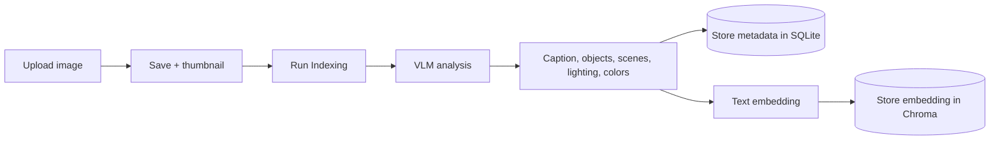
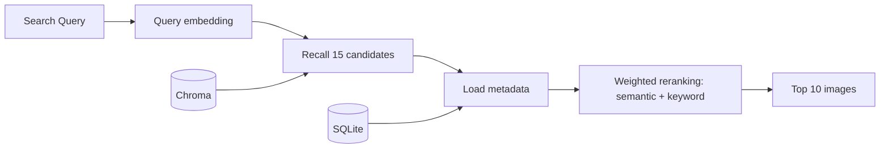

# Vision-Index 1.0 — Legacy

**Local-first multimodal image indexing and semantic retrieval system**

This is the archived VLM-based version. Active development focuses on [V2 product search](../README.md).

## Introduction

Vision-Index lets users upload images and search them with natural-language queries. 

It combines local VLM-based image understanding, text embeddings, vector retrieval, and two-stage search with reranking, all accessible through a FastAPI web dashboard.

**Tech Stack:** Python · FastAPI · Ollama · SQLite · ChromaDB

**Models:** `qwen3.5:4b` for image understanding · `nomic-embed-text:latest` for text embeddings.

---

## Demo

### Upload Images, Run Indexing, and Inspect Metadata


### Search by Queries and Inspect Ranking Scores


---

## Key Features

- **Local image understanding:** generate captions, objects, scenes, lighting, and colors through Ollama.
- **Semantic search:** retrieve images using embeddings of their generated descriptions.
- **Explainable ranking:** combine semantic similarity with field-level keyword scores.
- **Search evaluation:** measure retrieval quality on annotated queries.

---

## Pipeline Architecture

### Image Indexing


### Image Search



Search has two stages:

1. **Recall:** retrieve 15 candidates by vector distance.
2. **Rerank:** combine semantic and field-level keyword scores, then return the top 10.

---

## Evaluation

The original offline evaluation used 15 manually curated queries covering:

- object search
- scene search
- visual attributes
- compositional queries

| Top-1 Accuracy | Precision@5 | Recall@5 |
|---:|---:|---:|
| 80.00% | 57.33% | 70.60% |

Historical results from the weight-selection benchmark, not a held-out test set.

---

## Quick Start

Install Python 3.12 and start [Ollama](https://ollama.com/download), then download the models:

```bash
ollama pull qwen3.5:4b
ollama pull nomic-embed-text:latest
```

Run from the **repository root**, not from `app_legacy/`:

```powershell
python -m venv .venv
.\.venv\Scripts\Activate.ps1
python -m pip install -r requirements.txt
python -m uvicorn app_legacy.main:app --reload --port 8001
```

If the project environment is already installed and Ollama is running, only the last command is needed.

Open [localhost:8001](http://localhost:8001). Upload images or place them in `data/legacy/gallery/inbox/`, run indexing, then search.

Legacy data is separate from V2:

```text
data/legacy/
├── gallery/
│   ├── inbox/       # Original images
│   └── thumbs/      # Thumbnails
├── images.db       # Image metadata
└── vector/         # Text-embedding index
```

Optional model and Ollama settings are configured in the repository-root `.env`; see [.env.example](../.env.example).
The current Docker configuration starts V2; use the local command above for V1.

Implementation: [Indexing](services/index.py) · [Search](services/search.py) · [Model calls](ai/llm.py).
More details: [Legacy technical notes](../doc/TECHNICAL.md).
